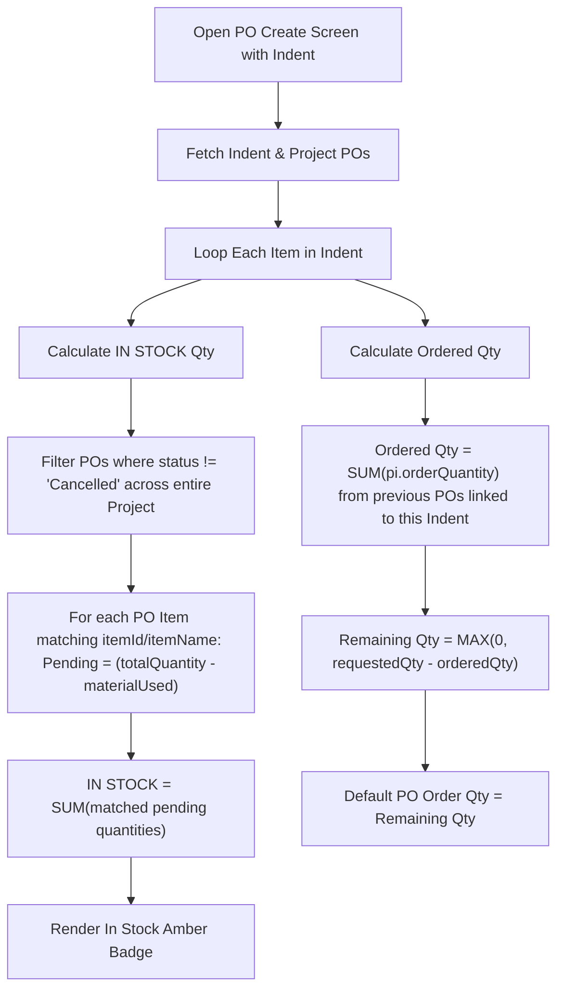

# PO Creation: In-Stock & Remaining Quantity Logic for Flutter App

This document provides complete API endpoints, request/response formats, computation formulas, and a ready-to-use Dart / Flutter implementation for displaying:
1. **IN STOCK** (Pending/on-site stock from previous Purchase Orders)
2. **REMAINING QUANTITY** (Indent Quantity minus already Ordered Quantity)
3. **EXCEEDS / FULLY ORDERED Warnings**

---

## 1. Overview & Business Rules

When raising a Purchase Order (PO) against an Indent:

| Column | What It Means | Computation Formula |
| :--- | :--- | :--- |
| **IN STOCK** | Available / received unconsumed stock on site from previous POs for this project | $\text{InStock} = \sum \max(0, \text{Total Received} - \text{Material Used / Issued})$ across project POs |
| **PO ORDER QTY (Default)** | Default quantity to order for this item from the Indent | $\text{RemainingQty} = \max(0, \text{Requested (Indent) Qty} - \text{Already Ordered Qty in previous POs})$ |
| **STATUS BADGES** | Helper warnings under quantity input | • If $\text{PO Order Qty} > \text{RemainingQty} \implies$ **"Exceeds (Remaining)"**<br>• If $\text{RemainingQty} == 0 \implies$ **"Fully ordered"**<br>• If already raised $\implies$ **"PO already created"** |

---

## 2. API Endpoints Needed

### 2.1 Get Indent Details (The Indent being converted to PO)
- **Method:** `GET`
- **Endpoint:** `/api/v1/indents/{indentId}` (or `/indents/{id}`)
- **Headers:** `Authorization: Bearer <TOKEN>`

#### Example Response:
```json
{
  "success": true,
  "data": {
    "indent": {
      "_id": "66f1a8e02b89f89f89f89100",
      "indentNo": "IND-2026-0038",
      "projectId": {
        "_id": "66e01a1b2c3d4e5f6a7b8c9d",
        "name": "Ecom Residency"
      },
      "status": "Approved",
      "items": [
        {
          "_id": "item_row_01",
          "itemId": {
            "_id": "66e8f6b217a8e02b89f89f38",
            "name": "item 380",
            "itemName": "item 380",
            "price": 11
          },
          "quantity": 100,
          "unitId": {
            "_id": "unit_01",
            "name": "greams"
          },
          "rate": 11
        }
      ]
    }
  }
}
```

---

### 2.2 Get Previous Purchase Orders for the Project
To compute both **In Stock** and **Already Ordered Quantity**, fetch all Purchase Orders created for that project.

- **Method:** `GET`
- **Endpoint:** `/api/v1/purchase-orders?projectId={projectId}&limit=1000`
- **Headers:** `Authorization: Bearer <TOKEN>`

#### Example Response:
```json
{
  "success": true,
  "data": [
    {
      "_id": "670a5908d47270a88099d10d",
      "poNo": "PO-2026-0120",
      "status": "Received",
      "indentId": "66f1a8e02b89f89f89f89100",
      "projectId": "66e01a1b2c3d4e5f6a7b8c9d",
      "totalCount": 500,
      "materialUsed": 60,
      "pending": 440,
      "items": [
        {
          "itemId": {
            "_id": "66e8f6b217a8e02b89f89f38",
            "name": "item 380"
          },
          "indentQuantity": 100,
          "orderQuantity": 60,
          "totalQuantity": 500,
          "materialUsed": 60,
          "pending": 440,
          "unit": "greams"
        }
      ]
    }
  ]
}
```

> **Note on Non-Cancelled Filter:** Always filter out POs where `status == "Cancelled"`.

---

## 3. Mathematical Logic & Step-by-Step Flow



### Formula 1: Already Ordered & Remaining Quantity
For an item in the current indent:
```
OrderedQty = sum of (item.orderQuantity) across all POs where po.indentId == currentIndent._id
RemainingQty = max(0, requestedQty - OrderedQty)
```
- If `RemainingQty > 0`: Default input value = `RemainingQty`
- If `RemainingQty == 0`: Default input value = `0` (Shows **"Fully ordered"**)

### Formula 2: IN STOCK (Pending from Previous POs)
For any line item inside a PO:
```
TotalQty = pi.totalQuantity ?? pi.totalCount ?? po.totalCount ?? pi.orderQuantity
Used = pi.materialUsed ?? po.materialUsed ?? pi.issuedToRequesterQuantity ?? 0
Pending = pi.pending ?? po.pending ?? max(0, TotalQty - Used)
```
Then for the Indent item `currentItem`:
```
InStockQty = sum of (Pending) for all items in all non-cancelled Project POs where:
   poItem.itemId == currentItem.itemId OR poItem.itemName == currentItem.itemName
```

---

## 4. Flutter / Dart Implementation Reference

Here is a copy-paste ready Dart service and model structure for Flutter developers:

### 4.1 Data Models (`po_models.dart`)

```dart
class IndentItem {
  final String id;
  final String itemId;
  final String name;
  final String unit;
  final double requestedQty;
  final double unitPrice;

  IndentItem({
    required this.id,
    required this.itemId,
    required this.name,
    required this.unit,
    required this.requestedQty,
    required this.unitPrice,
  });

  factory IndentItem.fromJson(Map<String, dynamic> json) {
    final itemObj = json['itemId'] is Map<String, dynamic> ? json['itemId'] : {};
    final unitObj = json['unitId'] is Map<String, dynamic> ? json['unitId'] : {};

    return IndentItem(
      id: json['_id'] ?? '',
      itemId: (itemObj['_id'] ?? json['itemId'] ?? json['_id'] ?? '').toString(),
      name: itemObj['name'] ?? itemObj['itemName'] ?? json['name'] ?? 'Item',
      unit: unitObj['name'] ?? unitObj['unitName'] ?? json['unit'] ?? 'Pcs',
      requestedQty: (json['quantity'] ?? json['indentQuantity'] ?? 0).toDouble(),
      unitPrice: (json['rate'] ?? json['price'] ?? itemObj['price'] ?? 0).toDouble(),
    );
  }
}

class ProjectPOItem {
  final String itemId;
  final String itemName;
  final double pending;
  final double orderQuantity;
  final String? indentId;

  ProjectPOItem({
    required this.itemId,
    required this.itemName,
    required this.pending,
    required this.orderQuantity,
    this.indentId,
  });
}
```

### 4.2 Stock & Remaining Calculation Helper (`po_calculator.dart`)

```dart
class POCalculator {
  /// 1. Extract flattened items with pending stock from all project POs
  static List<ProjectPOItem> extractProjectPOItems(List<dynamic> rawPOs) {
    List<ProjectPOItem> extracted = [];

    for (var po in rawPOs) {
      if (po['status'] == 'Cancelled') continue;

      final indentId = po['indentId'] is Map ? po['indentId']['_id'] : po['indentId']?.toString();
      final items = (po['items'] as List<dynamic>?) ?? [];

      for (var pi in items) {
        final itemObj = pi['itemId'] is Map ? pi['itemId'] : {};
        final itemId = (itemObj['_id'] ?? pi['itemId'] ?? '').toString().trim().toLowerCase();
        final itemName = (itemObj['name'] ?? itemObj['itemName'] ?? pi['name'] ?? '').toString().trim().toLowerCase();

        final orderQty = (pi['orderQuantity'] ?? pi['quantity'] ?? 0).toDouble();
        final totalQty = (pi['totalQuantity'] ?? pi['totalCount'] ?? (items.length == 1 ? po['totalCount'] : null) ?? orderQty).toDouble();

        // Calculate material used
        double materialUsed = 0.0;
        if (items.length == 1 && po['materialUsed'] != null) {
          materialUsed = (po['materialUsed']).toDouble();
        } else if (pi['materialUsed'] != null) {
          materialUsed = (pi['materialUsed']).toDouble();
        } else if (pi['issuedToRequesterQuantity'] != null) {
          materialUsed = (pi['issuedToRequesterQuantity']).toDouble();
        }

        // Calculate pending stock
        double pending = 0.0;
        if (items.length == 1 && po['pending'] != null) {
          pending = (po['pending']).toDouble();
        } else if (pi['pending'] != null) {
          pending = (pi['pending']).toDouble();
        } else {
          pending = (totalQty - materialUsed).clamp(0.0, double.infinity);
        }

        extracted.add(ProjectPOItem(
          itemId: itemId,
          itemName: itemName,
          pending: pending,
          orderQuantity: orderQty,
          indentId: indentId,
        ));
      }
    }

    return extracted;
  }

  /// 2. Compute IN STOCK (Pending from previous POs)
  static double getInStockQty({
    required IndentItem item,
    required List<ProjectPOItem> allProjectPOItems,
  }) {
    final targetId = item.itemId.trim().toLowerCase();
    final targetName = item.name.trim().toLowerCase();

    double inStock = 0.0;
    for (var poItem in allProjectPOItems) {
      bool isMatch = false;

      // Match by ID
      if (targetId.isNotEmpty && poItem.itemId.isNotEmpty) {
        if (poItem.itemId == targetId ||
            targetId.contains(poItem.itemId) ||
            poItem.itemId.contains(targetId)) {
          isMatch = true;
        }
      }

      // Fallback match by Name
      if (!isMatch && targetName.isNotEmpty && poItem.itemName.isNotEmpty) {
        if (targetName == poItem.itemName && !poItem.itemName.startsWith('material')) {
          isMatch = true;
        }
      }

      if (isMatch) {
        inStock += poItem.pending;
      }
    }

    return inStock;
  }

  /// 3. Compute Already Ordered Qty & Remaining Qty for Current Indent
  static double getRemainingQty({
    required IndentItem item,
    required String currentIndentId,
    required List<ProjectPOItem> allProjectPOItems,
  }) {
    final targetId = item.itemId.trim().toLowerCase();
    final targetName = item.name.trim().toLowerCase();

    double orderedQty = 0.0;

    for (var poItem in allProjectPOItems) {
      if (poItem.indentId != currentIndentId) continue;

      bool isMatch = false;
      if (targetId.isNotEmpty && poItem.itemId.isNotEmpty) {
        if (poItem.itemId == targetId ||
            targetId.contains(poItem.itemId) ||
            poItem.itemId.contains(targetId)) {
          isMatch = true;
        }
      }
      if (!isMatch && targetName.isNotEmpty && poItem.itemName.isNotEmpty) {
        if (targetName == poItem.itemName && !poItem.itemName.startsWith('material')) {
          isMatch = true;
        }
      }

      if (isMatch) {
        orderedQty += poItem.orderQuantity;
      }
    }

    final remaining = item.requestedQty - orderedQty;
    return remaining < 0 ? 0.0 : remaining;
  }
}
```

---

### 4.3 Flutter UI Widget Example (Matching the Web UI)

```dart
Widget buildInStockBadge(double inStockQty, String unit) {
  if (inStockQty > 0) {
    return Container(
      padding: const EdgeInsets.symmetric(horizontal: 10, vertical: 4),
      decoration: BoxDecoration(
        color: const Color(0xFFFFFBEB), // bg-amber-50
        borderRadius: BorderRadius.circular(8),
        border: Border.all(color: const Color(0xFFFDE68A)), // border-amber-200
      ),
      child: Column(
        mainAxisSize: MainAxisSize.min,
        children: [
          Text(
            '${inStockQty.toStringAsFixed(0)}',
            style: const TextStyle(
              color: Color(0xFFB45309), // text-amber-700
              fontWeight: FontWeight.bold,
              fontSize: 13,
            ),
          ),
          Text(
            unit,
            style: const TextStyle(
              color: Color(0xFFB45309),
              fontWeight: FontWeight.w600,
              fontSize: 10,
            ),
          ),
        ],
      ),
    );
  }

  return Text(
    '0 $unit',
    style: const TextStyle(
      color: Colors.grey,
      fontWeight: FontWeight.w600,
      fontSize: 12,
    ),
  );
}
```

---

## 5. Summary Checklist for Flutter Team

1. Call `GET /api/v1/purchase-orders?projectId={projectId}&limit=1000`.
2. Filter out any PO where `status == "Cancelled"`.
3. Compute `pending` for each item as `totalQuantity - materialUsed`.
4. Match by `itemId` (or fallback to `itemName`).
5. **In Stock Badge**: Display $\sum \text{Pending}$ across the whole project in amber badge if $>0$.
6. **PO Order Qty Input**: Set default value to `RemainingQty = max(0, requestedQty - orderedQty)`.
7. **Validation**: If user types more than `RemainingQty`, display red helper text `Exceeds (RemainingQty)`.
